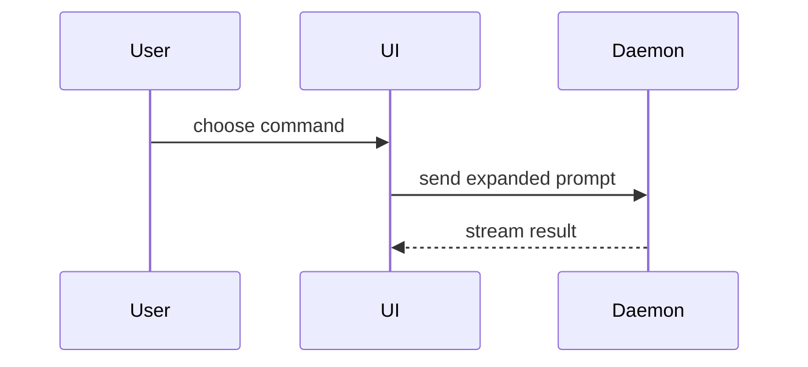

Use a Claude opus-5-5 subagent to write your PR descriptions, including this skill in the prompt. If you are a Claude Opus model, this is not necessary.

Use this template for writing the PR body:

```markdown
## Summary

<one sentence summary: problem, solution>

<diagram, diff-sketch, or tree>

## Evidence

<details>
  <summary>Before</summary>
  **Before:** <screenshot/output/failing test run>
</details>
<details>
  <summary>After</summary>
  **After:** <screenshot/output/passing test run>
</details>

## Merge Danger

**Door:** <one-way or two-way>

<optional: description>

**Blast Radius:** <one-word description>

<optional: potential ramifications of merge>
```

## Sections

Use ASD-STE100 Simplified Technical English, at a 10th grade reading label or less. 

Follow Nielsen Norman Group guidelines for scannable, readable content. Use the inverted pyramid style for each section.

Your theory of mind of the reader is that they are broadly familiar with the repository, but have not seen any of your context, did not read your session with the user, and needs a quick refresher on this part of the codebase. 

Use the user's domain language from `GLOSSARY.md`, if present.

If any section exceeds 150 words, put additional supporting content inside a `<details>` expandable block.

### Summary

Start with a single sentence which describes the "why" and "what".

- Show logic or an algorithm as pseudocode:

```text
on(save)
  if content is unchanged
    return cached result
  write new content
  return fresh result
```

- Show runtime control flow as a call tree:

```text
submitForm
  createSession
    persistPrompt
    launchAgent
  navigateToSession
```

- Show UI structure as a component tree, including state and module boundaries that matter:

```text
<SessionPage> (apps/example/src/routes/session.tsx)
  useSessionEvents()
  <SessionToolbar>
    <RunSkillButton> (packages/ui)
```

- Show file responsibility or a broad refactor as a shallow file tree:

```text
src/
├── commands/       # parses user actions
├── sessions/       # owns session state
└── transport/      # sends API requests
```

- Show component interaction, control flow, or data flow with Mermaid:



- Use `diff` when the point is what changes and the surrounding shape already exists. Match the diff shape to the topic.

For a component change:

```diff
 <SessionPage>
   useSessionEvents()
   <SessionToolbar>
+    <RunSkillButton />
   <SessionTimeline>
+    <SkillResultCard />
```

For a file-layout change:

```diff
 src/
 ├── commands/
+│   └── show-me.ts       # expands the slash command
 ├── sessions/
-└── transport.ts
+└── transport/
+    ├── client.ts
+    └── stream.ts
```

For a call-tree or call-stack change:

```diff
 submitForm
   createSession
     persistPrompt
+    expandSkillMention
     launchAgent
-  navigateToSession
+  navigateToSession
+    subscribeToEvents
```

For a state or control-flow change:

```diff
 on(save)
-  write content
+  if content is unchanged
+    return cached result
+  write new content
+  invalidate cache
```

- Show the whole block when most of it is new, when omitted context would hide ownership or order, or when the user needs a copyable target shape:

```ts
function expandSkill(command: string): string {
  const skillName = command.slice(1);
  return `use the ${skillName} skill`;
}
```

#### Guidance

Place each visual next to the short text it supports. Keep only the calls, files, props, states, and boundaries needed to answer the user's current question or the options to resolve the current discussion point.

### Evidence

Concrete evidence that the change works. Show a before and after.

Screenshots are S-tier - when the environment is set up for it and the change is visual.

Execution-based evidence is A-tier. Test results, console output. Show the exact test that now fails and passes, using pseudocode.

### Merge Danger

Describe whether it's a one-way or two-way door. You can walk back through two-way doors, but not one-way doors. A PR that is cheap to roll back is lower risk. Changes that involve destructive actions or hard-to-reverse decisions are one-way doors.

The blast radius is the potential impact or scope of the changes introduced by this PR. Consider all possibilities. Examples are layout shift, breakages for consumers, mobile responsiveness, etc.

#### Risk 

**Merge risk: <low-medium-high>**

**<category>:** <verdict>
<list gaps that increase risk. Use bullets, keep succinct. Include links to relevant files as needed>

<details>
<...list all categories>
</details>
```

These are the **categories** and **verdicts** that affect risk, with descriptions of what "low risk" means:

- **Alignment (poor ⚠️ / decent 👀 / good ✅):** Code aligns with the description and source issue, when present. Behavior assumptions and drive-bys must be documented.
- **Impact (large ⚠️ / medium 👀 / small ✅):** Scope is contained and away from sensitive code paths.
  - Consider blast radius: potential impact or scope of the changes introduced by this PR. Consider all possibilities. Examples are layout shift, breakages for consumers, mobile responsiveness, etc.
  - Sensitive areas carry outsized risk regardless of diff size: auth, permissions, payments, PII, secrets, data migrations, dependency bumps, and infra or config changes. Flag any that are touched, and call out anything that widens access, weakens validation, or logs sensitive data.
- **Verification (poor ⚠️ / decent 👀 / good ✅):** Behavior is verified, where applicable.
  - Changes to the user experience **need** end-to-end proof as screenshots or recordings. Changes that could meaningfully affect performance **need** profiling. Prefer before-and-after evidence to standalone proof. When this coverage is lacking, it's a failure.
  - Edge cases must be tested, or documented when they aren't; review the code closely and link the user to relevant code when only documentation is present.
- **Rollback cost (high ⚠️ / medium 👀 / low ✅):** The code is reversible once merged. Consider one-way vs. two-way doors. You can walk back through two-way doors, but not one-way doors. A PR that is cheap to roll back is lower risk. Changes that involve destructive actions or hard-to-reverse decisions are one-way doors.
- **Error detection (poor ⚠️ / decent 👀 / good ✅ / N/A ✅):** If applicable, critical flows should be monitored; If this breaks in production, someone should find out before users report it. Look for swallowed errors or fallbacks that hide breakage.

Generate a risk score for merging this PR on a scale of low - medium - high.

Verdicts:

- ⚠️ = 3
- 👀 = 2
- ✅ = 1

Weights:

- Impact = 2x
- Verification = 2x
- Rollback cost = 1.5x
- Error detection = 1x
- Alignment = 1x

Score = Σ(score × weight) / Σ(weights).

- low: < 1.5
- medium: 1.5 – < 2.25
- high: ≥ 2.25

Keep the numerical score and its calculations internal; do not include them in the output.
